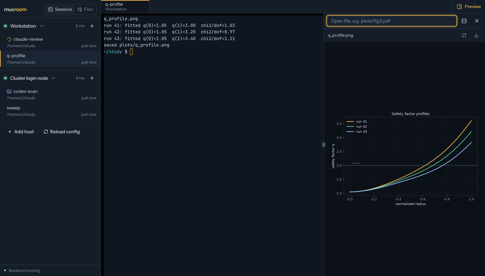

# muxroom

> **Status: early (0.1).** A young project. Tested with
> macOS as the dashboard machine and Linux/macOS remote hosts; the test suite
> also runs on Linux (CI), but Linux as the dashboard machine has seen little
> real use yet. Expect rough edges and breaking config changes before 1.0.



A local-first browser dashboard for the tmux sessions on your machines. It
finds the sessions on your laptop and on SSH hosts, starts new ones (optionally
running Claude Code, Codex CLI or OpenCode), and gives you real interactive
terminals in browser tabs. It also includes a file browser and a live plot
preview next to the terminal.

**muxroom never owns your processes.** Everything runs inside tmux on each
host. Closing a tab, the browser or muxroom itself, or losing SSH or VPN,
only detaches. Your agents keep running, and you can reattach from muxroom
or from a plain terminal (`tmux attach`). No daemon is installed on remote
hosts.

## Features

- Hosts with live status (reachable, needs sign-in, host-key problem, tmux missing)
- Session discovery per host, plus creation in a chosen directory, optionally with an agent
- Rename sessions in place (pencil icon or double-click); open tabs follow the new name and stay attached
- Agent activity: a spinner while Claude Code / Codex / OpenCode is working, a keyboard icon when it waits for your input
- Full terminals via xterm.js: keyboard, colours, resize, multiple tabs, the same session in several places
- Automatic reattach after network drops or muxroom restarts
- File browser limited to configured folders: download, upload, symlink-safe
- Split view with terminal | preview for PDF, PNG, JPEG and SVG, refreshing when the file changes
- Open plots by path relative to the session's current directory (`plots/fig3.pdf`)

## Requirements

- macOS or Linux running the dashboard; Python 3.13 via [uv](https://docs.astral.sh/uv/); Node 20+ to build the UI
- tmux on every host; OpenSSH client for remote hosts
- See [docs/remote-setup.md](docs/remote-setup.md) for what remote hosts need

## Quick start

```sh
git clone https://github.com/marjohma/muxroom.git && cd muxroom
make install          # uv sync + npm install
mkdir -p ~/.config/muxroom
cp config.example.toml ~/.config/muxroom/config.toml   # edit hosts and folders
make run              # builds the UI and starts http://127.0.0.1:8765
```

On startup muxroom prints an access link (`http://127.0.0.1:8765/#token=…`;
`--open` opens it for you). The token is stored with mode 0600 in
`~/.config/muxroom/token` and stays valid across restarts; each browser tab
needs the link once (or paste it on the sign-in screen). Run
`muxroom --rotate-token` to revoke it.

Without a config file muxroom manages only the local machine.

## Configuration

Everything is set in one TOML file; see [`config.example.toml`](config.example.toml).

| Setting | Purpose |
|---|---|
| `[[hosts]]` `transport` | `local`, `openssh` (system ssh, full `~/.ssh/config` support) or `asyncssh` (pure Python, key auth only) |
| `ssh_host` | alias from `~/.ssh/config` |
| `tmux_path`, `tmux_socket` | tmux binary and optional separate tmux server |
| `allowed_roots` | where new sessions may start |
| `files.read_roots`, `files.upload_roots` | what the file browser may read / where it may write |
| `agents` | which agents may be launched on a host |
| `[agents.<id>]` | label and command per agent |
| `[files]` | preview / download / upload size limits |

Config path: `--config PATH`, `$MUXROOM_CONFIG`, or `~/.config/muxroom/config.toml`.

**From the UI:**

- **Reload config** re-reads the file after you edit it. Unchanged hosts keep
  their connections, and open terminals stay attached. Changes to
  `[server]` (port, bind, …) still need a restart. An invalid file is
  rejected with the validation errors, and the previous configuration stays
  active.
- **Add host** lists the `Host` aliases from `~/.ssh/config`, tests the
  connection (and suggests a tmux path if tmux isn't on the PATH), then
  appends the host to the config file. Comments and formatting are kept,
  the previous version is saved as `config.toml.bak`, and the result is
  validated before it is written. Hosts can only be added for aliases you
  have already set up in ssh. Options that could run local commands
  (`ssh_options`, `ssh_config`, e.g. `ProxyCommand`) can only be set in the
  file. Editing or removing hosts also happens in the file. Set
  `server.allow_host_editing = false` to disable adding hosts from the UI.

## Agent activity

Refreshes run every 3 s while the muxroom window has focus or an agent
on that host is working, and every 15 s otherwise. Focusing the window
refreshes at once, and hidden browser tabs pause. Each refresh runs one
command per host through a long-lived remote shell. It lists the tmux panes, the host's clock, and the foreground
process of each pane's terminal (`ps -t`, only those terminals). Refreshes
are shared between all open windows and tabs, and status checks reuse the
last successful refresh. A pane runs an agent when that process
matches a configured agent: by default the program name of the agent's
`command`, looking through interpreters such as `node`. Add
`process_names = [...]` to an agent if it shows up under another name.

- **Working** (spinner): the pane produced output within the last 4 seconds.
  The agents redraw a spinner continuously while they work.
- **Waiting for input** (keyboard icon): the agent runs, but the pane has
  been silent longer than that.

This is a heuristic based on terminal output only and needs no setup on the
hosts. Typing into an agent's prompt briefly counts as output. An agent
that pauses without animating would show as waiting.

## Security model

- Binds to `127.0.0.1`. Other addresses need `--allow-remote-bind`.
- Every API request needs the access token as `Authorization: Bearer`;
  WebSockets carry it as a subprotocol. There are deliberately **no cookies**:
  browsers send cookies to every port on 127.0.0.1, so any other local server
  could collect them. The token travels in the link's URL fragment (never sent
  to the server or logged) and lives in per-tab `sessionStorage`. Images,
  PDFs and downloads use short-lived HMAC-signed URLs bound to one file.
- `Host` and `Origin` headers are checked against an allowlist (DNS
  rebinding, cross-site WebSocket hijacking); the UI is served with a strict
  Content-Security-Policy and may not be framed.
- Request bodies, WebSocket frames and command output have size limits.
- Only configured hosts and agents can be used. The browser sends an agent
  *name*, never a command line. Session names, ids and paths are validated.
  All commands are built as argument vectors, and the only string conversion
  is a single `shlex.join` for the remote shell.
- File access is confined to configured roots after resolving symlinks
  (`realpath` plus path-component containment).
- Previews are treated as untrusted. SVG is only shown via `` and served
  with `Content-Security-Policy: sandbox`. Downloads are always
  `Content-Disposition: attachment` with `nosniff`.
- No credentials are stored. Remote access relies on your SSH setup (agent,
  ControlMaster, Kerberos). Password hosts use the one-time **Sign in**
  terminal, where you type directly into `ssh`.
- Terminal output and file contents are never logged or persisted.

## Development

```sh
make dev            # backend with reload on :8765 + Vite on :5173 (open the printed link)
make test           # backend (pytest) + frontend (vitest)
make lint           # ruff, oxlint, tsc
make test-remote    # opt-in: MUXROOM_REMOTE_HOST=<alias> [MUXROOM_REMOTE_TMUX=...]
```

Layout: `backend/` (FastAPI, transports, tmux, file services), `frontend/`
(React, TanStack Query, xterm.js, shadcn/ui), `docs/` (remote setup, SSH
compatibility), `scripts/` (persistence probe, spikes).

Backend tests use fake transports, real tmux on private sockets, an in-process
SSH/SFTP server, and a real server process that is killed with SIGTERM,
SIGKILL and SIGINT to prove that sessions survive.

## Limitations

- Remote login shells must be POSIX (bash, zsh, sh, dash, ksh). fish and tcsh are reported as unsupported.
- The PDF preview uses the browser's built-in viewer.
- Browser shortcuts (Cmd+W, Cmd+T, …) are captured by the browser. Install the page as an app window to free most of them.
- Scrollback lives in tmux (use copy mode or `set -g mouse on`). The browser only shows output since the attach.

## Reporting security issues

See [SECURITY.md](SECURITY.md).

## License

MIT, see [LICENSE](LICENSE).
